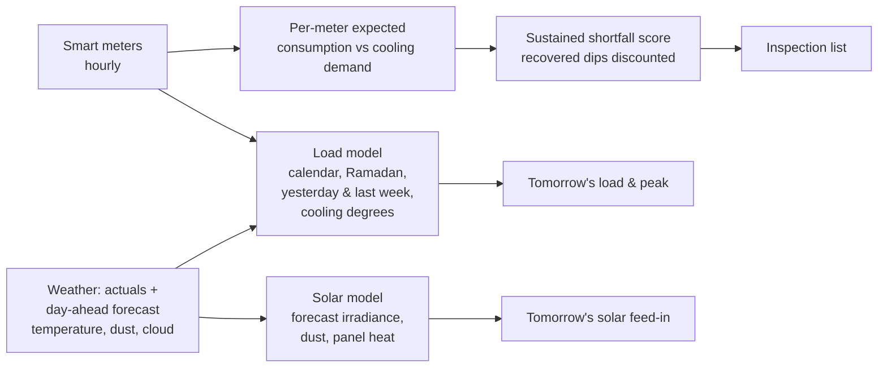

# ⚡ UAE Energy & Smart Grid Analytics

**Three daily decisions for a UAE utility: how much power the network will need tomorrow, how much rooftop
solar will feed in, and which meters to inspect for tampering.**

> Data: a simulated Dubai distribution network over two years: hourly weather with 45 °C summer afternoons and
> spring-summer dust storms, 400 smart meters (villas, apartments, commercial, industrial) whose load is driven by
> air-conditioning, Ramadan and weekends, 5 MWp of rooftop solar (Shams Dubai style), and meters tampered with partway
> through the year alongside legitimate look-alikes (empty holiday homes, shops closed for renovation). Illustrative values.

---

## Results (test period July to December 2025)

**Day-ahead network load, hourly**

| Method | Error (MAPE) | Summer afternoon peak hours |
|---|---|---|
| **Gradient boosting with tomorrow's temperature forecast** | **3.7%** | **2.9%** |
| Same model without weather | 6.7% | |
| Same hour last week | 8.5% | 6.5% |

Tomorrow's daily peak is forecast within **3.2%**. In the UAE, air-conditioning is most of the load, so the
temperature forecast more than halves the error versus the usual "same as last week" method, exactly at the
summer afternoon peak that decides how much generation and import capacity to schedule.

**Day-ahead rooftop solar, daylight hours (error as % of installed capacity)**

| Method | All days | Dust days |
|---|---|---|
| **Gradient boosting on the weather forecast** | **1.0%** | **2.8%** |
| Physical model with forecast irradiance | 3.5% | 5.2% |
| Yesterday, same hour | 4.9% | 14.4% |
| Clear-sky physical model | 6.2% | 29.4% |

Dust storms are where simple methods fail: assuming tomorrow looks like today or like a clear sky is off by
14 to 29% of capacity. The model learns dust, heat losses on hot panels and soiling between cleanings.

**Meter tampering, 20 field inspections this month (400 meters, 24 tampered)**

| Inspection list ranked by | Hit rate | Tampered meters found | Monthly loss recovered |
|---|---|---|---|
| **Weather-adjusted expected vs actual consumption** | **75%** | **15** | **AED 10.7K** |
| Year-on-year drop rule | 60% | 12 | AED 9.1K |

Each meter's normal consumption is learned from its own history against cooling demand, so a sustained shortfall
stands out; temporary dips that recover (holidays, renovations) are discounted. It needs no labelled theft cases.

---

## How it works



| Component | Where |
|---|---|
| Weather, meters, tampering and solar simulator | `src/energy/simulate.py` |
| Load and solar forecasting, tampering scores, year-on-year rule | `src/energy/models.py` |
| Backtest and report | `src/energy/pipeline.py` |
| Grid operator dashboard | `dashboard.py` |

## Quick start

```bash
git clone https://github.com/vineethasusan/uae-energy-smart-grid-analytics.git
cd uae-energy-smart-grid-analytics
python -m venv .venv && source .venv/bin/activate
make install
make pipeline     # -> outputs/report.md, inspection_list.csv
make dashboard    # http://localhost:8501
```

## Design decisions

- **Forecast with what you will actually know.** The day-ahead models use the weather *forecast*, not the actual
  weather, and only load data available the day before.
- **Weather is the main driver in the Gulf.** Cooling degrees explain most of the load, so the model is built around them.
- **Unsupervised theft detection.** Utilities rarely have clean labels; comparing each meter with its own
  weather-adjusted normal works from day one and gives inspectors a reason (sustained shortfall since a date).
- **Separate real drops from fraud.** Holiday homes and renovations look like theft for a few weeks; consumption that
  recovers is discounted.

## Roadmap

- Probabilistic (P10/P90) load forecasts for reserve planning
- EV charging and district-cooling load as separate components
- Feeder-level energy balance (energy delivered vs billed) to localise technical and commercial losses
- Battery dispatch optimisation against the solar and load forecasts

## Author

**Vineetha Susan Alexander** · Senior Data Scientist & AI Consultant, Dubai
[LinkedIn](https://www.linkedin.com/in/vineetha-susan-alexander-465997135) · [GitHub](https://github.com/vineethasusan)

MIT License.
